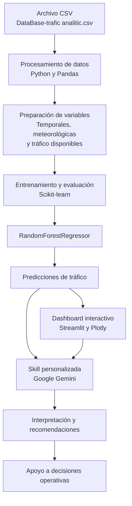

# Dashboard de Analítica y Predicción de Tráfico Vehicular con Machine Learning y Skills de Gemini

**Proyecto académico de Ingeniería Informática**

Sistema de análisis y predicción de tráfico vehicular mediante Machine Learning, visualización interactiva de datos e inteligencia artificial generativa.

**Tecnologías principales:** Python, Pandas, Scikit-learn, Streamlit, Plotly y Google Gemini.

---

# PILAR 1. Problema y Contexto

## 1.1. Problemática

La congestión vehicular es un desafío para la movilidad urbana, ya que puede aumentar los tiempos de desplazamiento y dificultar la planificación de las vías. El análisis de datos y el Machine Learning permiten estudiar patrones históricos y estimar el comportamiento del tráfico.

## 1.2. Objetivo del proyecto

Desarrollar un dashboard interactivo que analice datos históricos, estime el volumen de tráfico vehicular y facilite la interpretación de resultados para apoyar la toma de decisiones.

## 1.3. Importancia en la ingeniería de software

El proyecto integra diferentes áreas de la ingeniería informática:

- **Ciencia de datos:** análisis y transformación de registros de tráfico.
- **Machine Learning:** aprendizaje de patrones para generar predicciones.
- **Visualización de datos:** presentación de indicadores mediante gráficos interactivos.
- **Inteligencia artificial:** interpretación de resultados con Google Gemini.
- **Ingeniería de software:** integración de componentes en una aplicación funcional.

## 1.4. Beneficios esperados

- Identificar las horas con mayor volumen de tráfico.
- Analizar tendencias temporales de movilidad.
- Estimar el volumen vehicular.
- Evaluar el desempeño del modelo predictivo.
- Facilitar la interpretación de los resultados mediante inteligencia artificial.

---

# PILAR 2. Arquitectura y Datos

## 2.1. Fuente de información

El proyecto utiliza el archivo:

`DataBase-trafic analitic.csv`

Este archivo contiene los registros históricos empleados para analizar el tráfico y preparar los datos para el entrenamiento del modelo.

## 2.2. Variables del proyecto

| Categoría | Variables | Función |
|---|---|---|
| Temporales | Hora, día y fecha, según las columnas disponibles | Identificar patrones de tráfico por periodo. |
| Meteorológicas | Temperatura, lluvia y nubosidad, si están disponibles | Analizar posibles relaciones entre clima y circulación. |
| Tráfico | Volumen vehicular registrado | Definir el comportamiento observado y la variable objetivo. |

Las variables que realmente utiliza el modelo deben corresponder a las columnas presentes en el archivo y al código de entrenamiento.

## 2.3. Procesamiento de datos

El procesamiento de información contempla las siguientes etapas:

1. Carga del archivo CSV.
2. Inspección de columnas y tipos de datos.
3. Limpieza de registros inconsistentes.
4. Tratamiento de valores faltantes, cuando sea necesario.
5. Transformación de variables temporales.
6. Selección de variables predictoras y variable objetivo.
7. División de los datos en conjuntos de entrenamiento y prueba.
8. Entrenamiento y evaluación del modelo.

## 2.4. Arquitectura lógica

- **Capa de datos:** archivo CSV con los registros históricos.
- **Capa de procesamiento:** limpieza y transformación con Python y Pandas.
- **Capa predictiva:** entrenamiento y evaluación con Scikit-learn.
- **Capa de visualización:** dashboard interactivo con Streamlit y Plotly.
- **Capa de inteligencia artificial:** interpretación de resultados mediante una Skill personalizada para Google Gemini.

**Idea clave:** la calidad de las predicciones depende de la calidad de los datos, la preparación de las variables y la evaluación correcta del modelo.

---

# PILAR 3. Modelo Machine Learning con sus métricas reales de Random Forest

## 3.1. Modelo utilizado

El algoritmo seleccionado es `RandomForestRegressor`, un modelo de aprendizaje supervisado diseñado para resolver problemas de regresión.

El modelo construye múltiples árboles de decisión y combina sus estimaciones para producir una predicción numérica. En este proyecto se utiliza para estimar el volumen de tráfico vehicular.

## 3.2. Funcionamiento

1. Recibe las variables de entrada.
2. Procesa las variables mediante los árboles entrenados.
3. Genera estimaciones individuales.
4. Combina las estimaciones.
5. Produce el volumen de tráfico predicho.

## 3.3. Métricas reales de evaluación

El modelo obtuvo los siguientes resultados durante su evaluación:

| Métrica | Resultado real | Interpretación |
|---|---:|---|
| MAE | 228.66 | Error absoluto medio de 228.66 unidades de volumen de tráfico. |
| RMSE | 426.29 | Error cuadrático medio que penaliza con mayor peso los errores grandes. |
| R² | 0.9524 | Coeficiente de determinación que indica un ajuste elevado en los datos evaluados. |
| R² porcentual | 95.24 % | Expresión porcentual del coeficiente de determinación, no del porcentaje de predicciones acertadas. |

## 3.4. Análisis de las métricas

### MAE: 228.66

El error absoluto medio indica que la diferencia absoluta promedio entre los valores reales y las predicciones es de 228.66 unidades, según la escala de la variable objetivo.

### RMSE: 426.29

El RMSE mide el error dando mayor importancia a las desviaciones grandes. Su valor, superior al MAE, indica que los errores de mayor magnitud influyen más en esta métrica.

### R²: 0.9524

El coeficiente de determinación indica un ajuste elevado respecto a la variabilidad observada en los datos de evaluación. Este resultado no significa que el modelo acierte el 95.24 % de las predicciones.

## 3.5. Interpretación general del modelo

Los resultados muestran que el modelo presenta un ajuste elevado en el conjunto evaluado. Sin embargo, su utilidad práctica también depende de la magnitud de los errores, la representatividad de los datos y la separación adecuada entre entrenamiento y prueba.

## 3.6. Visualización de resultados

El dashboard puede presentar los siguientes indicadores y gráficos, según las funcionalidades implementadas:

- Volumen de tráfico por hora.
- Comparación del volumen entre días.
- Valores reales frente a predicciones.
- Distribución de los errores.
- Indicadores MAE, RMSE y R².
- Importancia de las variables utilizadas por el modelo.

**Idea clave:** Random Forest genera las predicciones, las métricas permiten evaluar su desempeño y el dashboard facilita la interpretación de los resultados.

---

# PILAR 4. Integración con Inteligencia Artificial: Skill personalizada para Google Gemini

## 4.1. ¿Qué es la Skill de Gemini?

Una Skill personalizada permite orientar a Google Gemini hacia una tarea específica mediante instrucciones y, según su implementación, herramientas o acceso a datos.

En este proyecto, se plantea como un agente consultor que ayuda a interpretar los resultados del análisis de tráfico y a formular recomendaciones para su evaluación.

La Skill complementa al modelo predictivo, pero no reemplaza su entrenamiento ni constituye por sí sola un algoritmo de predicción.

## 4.2. Funciones del agente consultor

- Explicar los horarios con mayor volumen de tráfico.
- Interpretar las métricas del modelo.
- Resumir patrones encontrados en los datos.
- Analizar escenarios para los que existan predicciones disponibles.
- Proponer alternativas preventivas de movilidad.
- Comunicar las limitaciones de los resultados.

## 4.3. Ejemplo de interacción

**Pregunta:**

¿Qué horarios presentan mayor riesgo de congestión y qué acciones preventivas se podrían considerar?

**Respuesta ilustrativa:**

Con base en los registros y las predicciones disponibles, se pueden identificar las franjas horarias con mayor volumen estimado de tráfico. A partir de estos resultados, se pueden evaluar medidas como la gestión de semáforos, la comunicación de rutas alternativas y la planificación de recursos de movilidad.

Las recomendaciones deben contrastarse con información operativa actualizada antes de implementar cualquier medida.

## 4.4. Consideraciones técnicas

- La Skill debe utilizar resultados verificables.
- No debe inventar métricas ni valores de tráfico.
- Las predicciones deben identificarse como estimaciones.
- El acceso a datos actualizados requiere una integración técnica.
- Las decisiones operativas deben validarse con información real y supervisión humana.

**Idea clave:** Gemini aporta una capa conversacional que transforma los resultados técnicos en explicaciones y recomendaciones comprensibles.

---

# Diagrama técnico de la solución

El siguiente diagrama representa el flujo de información desde el archivo CSV hasta la predicción, la visualización y la interpretación mediante inteligencia artificial.

## Descripción de los componentes

| Componente | Responsabilidad |
|---|---|
| Archivo CSV | Proporcionar los registros históricos de tráfico. |
| Python y Pandas | Procesar y organizar los datos. |
| Scikit-learn | Entrenar y evaluar el modelo. |
| RandomForestRegressor | Estimar el volumen de tráfico. |
| Streamlit | Construir la interfaz interactiva. |
| Plotly | Visualizar tendencias y resultados. |
| Google Gemini | Interpretar los datos que recibe mediante la integración. |
| Skill personalizada | Facilitar explicaciones y recomendaciones. |

---

# Resultados e impacto del proyecto

| Área | Resultado | Interpretación |
|---|---|---|
| Análisis temporal | Estudio de patrones horarios | Facilita la identificación de periodos de mayor volumen. |
| Predicción | RandomForestRegressor | Estima el volumen de tráfico según las variables disponibles. |
| Error absoluto medio | MAE = 228.66 | Cuantifica el error absoluto promedio. |
| Error cuadrático medio | RMSE = 426.29 | Da mayor peso a los errores grandes. |
| Ajuste del modelo | R² = 0.9524 | Indica un ajuste elevado respecto a la variabilidad de los datos evaluados. |
| Visualización | Streamlit y Plotly | Facilita el análisis de los resultados. |
| Inteligencia artificial | Skill de Google Gemini | Apoya la interpretación y la evaluación de alternativas. |

Los indicadores representan resultados de la evaluación del modelo. Los beneficios operativos deben validarse con datos representativos y pruebas adicionales.

---

# Conclusión

El proyecto **Traffic Analytics – Dashboard de Analítica y Predicción de Tráfico Vehicular con Machine Learning y Skills de Gemini** integra procesamiento de datos, aprendizaje automático, visualización e inteligencia artificial generativa.

El modelo `RandomForestRegressor` obtuvo un MAE de 228.66, un RMSE de 426.29 y un R² de 0.9524 en la evaluación realizada. Estos resultados reflejan un ajuste elevado, aunque la utilidad de las predicciones debe analizarse teniendo en cuenta la escala de los datos y las condiciones de evaluación.

Streamlit y Plotly permiten explorar los resultados mediante una interfaz interactiva, mientras que una Skill personalizada de Google Gemini puede facilitar su interpretación y generar recomendaciones para apoyar la toma de decisiones.

La solución ofrece una base tecnológica para analizar patrones de movilidad y explorar alternativas de planificación, sin sustituir la validación humana ni la información operativa actualizada.

---

# Herramientas y tecnologías

- **Python:** lenguaje de programación principal.
- **Pandas:** procesamiento y análisis de datos.
- **Scikit-learn:** entrenamiento y evaluación del modelo de Machine Learning.
- **Streamlit:** desarrollo del dashboard interactivo.
- **Plotly:** construcción de gráficos interactivos.
- **Google Gemini:** interpretación conversacional mediante una Skill personalizada.

---

**Proyecto académico de Ingeniería Informática**

*Analítica de datos · Machine Learning · Ingeniería de software · Inteligencia artificial aplicada a la movilidad urbana*
